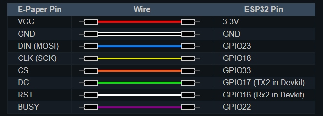

# esp_eink_frame

ESP32 + e-ink photo frame with SD card, RTC, battery, and a web UI for uploading images.

## Hardware

- MCU: ESP32 (PlatformIO env `upesy_wroom`, Arduino framework)
- Display: Waveshare 7.3inch e-Paper HAT (E) — E Ink Spectra 6 (E6), 800×480,
  SPI mode 0, 3.3 V
- SD card: SPI microSD module (HSPI)
- RTC: DS3231 (I2C)
- Wake-up button (GPIO35) and sleep status LED (GPIO2)
- Battery

## SPI buses

The display and the SD card use **two separate hardware SPI buses** on purpose.
The Waveshare e-Paper HAT carries an always-connected TXB0108 level translator
whose pull-ups / auto-direction circuitry disturbs a shared bus whenever the HAT
is powered, which made the SD card fail to initialise (`FR_NOT_READY`). Keeping
the devices on separate buses avoids the conflict entirely.

| Device | Bus  | SCK | MOSI | MISO |
|--------|------|-----|------|------|
| E-ink  | VSPI | 18  | 23   | —    |
| SD     | HSPI | 14  | 13   | 27   |

## E-ink wiring

| Display pin | ESP32 GPIO | Notes        |
|-------------|------------|--------------|
| SCK / CLK   | 18         | VSPI clock   |
| MOSI / DIN  | 23         | VSPI MOSI    |
| CS          | 33         | Chip select  |
| DC          | 17         | Data/Command |
| RST         | 16         | Reset        |
| BUSY        | 22         | Busy status  |
| VCC         | 3.3V       |              |
| GND         | GND        |              |

Pin constants:

```cpp
constexpr int EPD_SCK  = 18;
constexpr int EPD_MOSI = 23;
constexpr int EPD_CS   = 33;
constexpr int EPD_DC   = 17;
constexpr int EPD_RST  = 16;
constexpr int EPD_BUSY = 22;
```

## SD card wiring

| SD module pin | ESP32 GPIO | Notes               |
|---------------|------------|---------------------|
| SCK / CLK     | 14         | HSPI clock          |
| MOSI / DI     | 13         | HSPI MOSI           |
| MISO / DO     | 27         | HSPI MISO           |
| CS / SS       | 5          | SD-select           |
| VCC           | 3.3V       | ESP32 logic is 3.3V |
| GND           | GND        |                     |

Pin constants:

```cpp
constexpr int SD_SCK  = 14;
constexpr int SD_MOSI = 13;
constexpr int SD_MISO = 27;
constexpr int SD_CS   = 5;
```

## RTC wiring (DS3231, I2C)

The RTC uses the **alternate I2C pins 25/26**; GPIO 21/19 are reserved for other
peripherals. `SQW/INT` must be wired to an RTC GPIO so the DS3231 alarm can wake
the ESP32 from deep sleep. This build uses GPIO32.

| DS3231 pin | ESP32 GPIO | Notes                          |
|------------|------------|--------------------------------|
| VCC        | 3.3V       | module works at 3.3V           |
| GND        | GND        |                                |
| SDA        | 25         | I2C data                       |
| SCL        | 26         | I2C clock                      |
| SQW / INT  | 32         | alarm wake-up (active low), wake button in parallel |
| 32K        | —          | not used                       |

Pin constants:

```cpp
constexpr int RTC_SDA = 25;
constexpr int RTC_SCL = 26;
constexpr int RTC_INT = 32;
```

Most DS3231 modules already have pull-ups on SDA/SCL; the firmware additionally
enables the ESP32 internal pull-up on the INT line, so an external pull-up on
`SQW/INT` is optional.

## Wake button & sleep LED

### Forced wake-up button

A momentary push button between **GPIO32** and **GND**, wired in parallel with
the DS3231 `SQW/INT` output. Both are open-drain active-low signals on a line
held high by the ESP32 pull-up, so they can share it without contention, and a
press pulls the ext0 wake input exactly like the alarm does.

| Component | ESP32 pin | Notes                                                     |
|-----------|-----------|-----------------------------------------------------------|
| Button    | 32        | momentary, pin → GND, in parallel with the DS3231 INT pin |

Why the shared line instead of its own GPIO: on the classic ESP32 **ext0**
accepts only one pin, and **ext1** cannot OR several active-low inputs
together (it only supports "all selected pins low" / "any pin high"), so a
second active-low wake source simply is not arming-able in hardware.

The firmware tells the two wakes apart by the latched A1 flag in the DS3231:
the alarm sets it, a button press does not. A button wake is treated as a
normal cold boot (it also cancels the autonomy test), which makes the button
the "get the frame back without touching the battery" control.

### Sleep status LED

An LED that is **lit while the board is awake and dark in deep sleep**, wired
active-high: `GPIO2 → 330 Ω → LED(+) LED(−) → GND`.

| Component        | ESP32 pin | Notes                          |
|------------------|-----------|--------------------------------|
| LED + 330 Ω      | 2         | cathode to GND                 |

`deepSleep()` drives the pin low and latches (holds) it there before the chip
stops, and `AppController::begin()` lights it again right after wake — so the
LED is off for the whole sleep and on as soon as the firmware runs. GPIO2 is a
strapping pin, but the LED + resistor load to GND keeps it low at boot, which
is exactly the level GPIO2 must sample; a red LED (Vf ≈ 2 V) is the safe
choice. Do not wire the LED to 3.3 V (active low): that would hold the pin
high during boot.

Pin constants:

```cpp
constexpr int BTN_WAKE   = 32;  // shares the line with RTC_INT
constexpr int STATUS_LED = 2;
```

## Power rail (SD + e-Paper switch)

The microSD card and the e-Paper HAT share one switched 3.3 V rail driven by a
**high-side switch whose control input is pulled up to 3.3 V**, so the hardware
default (reset, bootloader, deep sleep, floating pin) is *off*.

`GPIO4` low → switch closed → rail powered. `GPIO4` high or floating → rail cut.
If a module with an active-high enable input is used instead, set
`config::PowerGateActiveHigh = true` in `src/config/AppConfig.h`.

### Option A — P-channel MOSFET (best, ~0 V drop)

A logic-level part specified for `Vgs = -2.5 V` is required; a standard-level
IRF9Z34N will not open fully from 3.3 V.

| MOSFET pin | Connect to | Notes                              |
|------------|------------|------------------------------------|
| Source     | 3.3 V      | from the buck-boost converter      |
| Drain      | SD VCC + e-Paper VCC | add 10 µF at each load   |
| Gate       | ESP32 GPIO 4 + 100 kΩ to 3.3 V | pull-up keeps the rail off |

For hand wiring prefer a **TO-220** part (`NDP6020P`, `IRF4905`) — SOT-23 is
impractical without a PCB.

### Option B — PNP transistor (through-hole, ~0.2–0.3 V drop)

Same logic levels as the MOSFET, no firmware change. An NPN **cannot** be used
high-side (an emitter follower delivers only `3.3 V − Vbe ≈ 2.6 V`, which is
exactly the undervoltage that breaks the SD card), and a low-side NPN would
float the load's ground and back-feed the signal lines.

| PNP pin | Connect to | Notes                                   |
|---------|------------|-----------------------------------------|
| Emitter | 3.3 V      |                                         |
| Collector | SD VCC + e-Paper VCC | add 10 µF at each load       |
| Base    | GPIO4 via **220 Ω**, plus **1 kΩ** from base to 3.3 V | 1 kΩ keeps it off at reset |

Suggested parts (TO-92/TO-220, `Ic ≥ 0.7 A`): `S8550`, `2N2907`, `BD140`,
`BD136`, `TIP32`. Base current ≈ 11 mA, so keep the forced beta ≈ 20 for a
~200–300 mA load. Expect ~3.0 V at the load; measure the collector under load
and stay above 2.95 V.

The firmware switches the rail on at boot (before the display and the card are
initialised, with a 300 ms settle delay) and cuts it in `power::deepSleep()` after
parking every signal line at 0 V. Parking matters: a high level on the SPI or CS
lines of an unpowered load pushes current through its ESD diodes and partially
powers it again.

Cutting the rail resets the peripherals, so both `Display::begin()` and
`SdCard::begin()` run again on every wake.

### Option C — no switch at all

Perfectly workable if the extra sleep current is acceptable: the e-Paper
`hibernate()` command already drops the panel to a few µA, and only the card
leaks. The card costs ~100–500 µA in SPI idle and the HAT's level translator a
few tens of µA, i.e. roughly 3–12 mAh per day — significant for a 180 mAh cell
but negligible on USB power. If in doubt, build without the switch first and add
it once everything else works.

## Web UI

`http://<address-of-the-frame>/` serves a single page with four tabs:
**Добавить** (pick, crop and correct one or several photos), **Библиотека** (the
stored photos), **Сеть** (Wi-Fi provisioning) and **Питание** (the autonomy
test). Everything is built in JavaScript and the result is exactly what the
panel gets: the browser renders an 800×480 frame, reduces it to the six Spectra
6 colours and uploads the finished 192 000 byte image, so a slow SD card or a
35 second refresh never has to be waited for while composing.

Editor:

* drag & drop or a multi-file picker - each file becomes a queue entry with its
  own name, crop and corrections; dropping a file anywhere opens the editor tab;
* rotate, mirror, free or fixed crop frame (5:3 is the panel);
* corrections grouped into collapsible sections (Тон, Цвет, Детали, Тонирование)
  that stay closed until opened and remember their state; a closed section still
  shows how many values inside it are changed;
* sliders do not re-render the preview by themselves: the preview panel shows
  "превью устарело" with an "Обновить превью" button, and an "Авто" checkbox
  switches to debounced live updates; saving always re-renders at full quality;
* corrections: exposure, brightness, contrast, black/white levels, gamma,
  shadows, highlights, saturation, desaturate, hue, temperature, tint, sharpen,
  blur, vignette, invert;
* presets (Ч/Б фото, контрастный, мягкий, газетный плакат, сепия, дупотон, ...)
  set corrections, colour subset and dithering at once;
* colour subset: all six, black and white only, or any custom combination, and
  the dithering mode (Floyd-Steinberg, Atkinson, Burkes, ordered Bayer, none);
* live preview with a hold-to-compare button and a 1:1 pixel view;
* names: the display name may be anything ("Море летом"); the file on the card
  gets an ASCII transliteration of it ("more-letom.e6").

Library: stored photos are listed as names only - a thumbnail would cost a 192 KB
read from the card - and the preview is fetched once you select an entry. From
there you can show it on the panel, rename it, open the stored frame back in the
editor (this jumps to the editor tab), download the raw `.e6` or delete it.

The layout is responsive down to a phone: one column, 38-46 px touch targets,
16px input text so iOS does not zoom the page when a field gets focus, and the
crop view sized to the visible panel and 42% of the screen height.

### API

| Endpoint | Method | Arguments | Purpose |
|----------|--------|-----------|---------|
| `/api/status` | GET | - | network, SD capacity, RTC, current image |
| `/api/images` | GET | - | `[{name,title,size,mtime,current}]` |
| `/api/file` | GET | `name` | raw `.e6` bytes of one image |
| `/api/images/upload` | POST | multipart `file` + `?title=` | store a finished frame |
| `/api/images/rename` | POST | `name`, `title` | change a display name |
| `/api/images/delete` | POST | `name` | remove image and its name |
| `/api/display` | POST | `name` | render an image on the panel |
| `/api/wifi` | POST | `ssid`, `password` | save and connect |
| `/api/wifi/reset` | POST | - | fall back to the setup AP |
| `/api/status-screen` | POST | - | render the status screen |
| `/api/autonomy-test` | POST | - | start the sleep loop |

Slugs always match `[A-Za-z0-9_-]{1,40}` and are the only thing used to build a
path. Titles are free text (UTF-8, up to 80 bytes, one line) and live in the
sidecar table `/images/meta.tsv`, one `<slug>\t<title>` per line, so FAT naming
never sees them. `ImageRepository::setTitle()` rewrites the whole table through
`meta.tmp` and renames it, which keeps the titles intact if power is lost.

Rendering an image blocks the firmware for 20-35 seconds: the page keeps polling
`/api/status` and reports "Рамка сейчас рисует изображение…" instead of a
connection error while that happens.

### Working on the UI without a board

```bash
python tools/dev_server.py            # http://127.0.0.1:8123
```

It serves `web/` and implements the endpoints above against `dev_store/`,
including the frame size check and the metadata table, so the whole page can be
developed and tested offline. `tools/make_test_png.py` produces an oversized
test image for the resampling path. Both are development tools, not part of the
firmware. The firmware itself bundles `web/*` into `src/web/WebAssets.generated.h`
before every build (`tools/embed_web_assets.py`), so a page change is picked up
by the next `pio run -t upload`: the new `web/` contents land in the firmware's
flash and are served straight from there.

### Troubleshooting intermittent mounts

`3.2 V` at the switched output is **not** a problem by itself: SD cards are
specified for 2.7–3.6 V. An `AO3401A` (marking `A19T`) is a logic-level
P-channel MOSFET with roughly 50–90 mΩ `Rds(on)` at `Vgs = -2.5…-3.3 V`; at the
~100 mA an SD card draws its drop is only ~10 mV. A measured 0.1 V drop is much
more likely to come from jumper wires, breadboard contacts or the DMM's own
accuracy than from the MOSFET.

What actually breaks cards is a **transient dip during a write burst** (up to
200 mA) or a card that was never fully powered down. Check in this order:

1. Measure VDD **at the card contacts**, not at the MOSFET, while a file is being
   written. If a scope is available, watch for dips; with a DMM use the min/max
   mode. Staying above 3.0 V is comfortable, 2.7 V is the absolute limit.
2. Measure the MOSFET **source** at the same time. If source is 3.3 V and the
   card is 3.2 V, the drop is in the wiring. If both are ~3.2 V, the 3.3 V source
   (converter/LDO/USB cable) is the limit.
3. Measure the switched output while the rail is **off** (gate high or in deep
   sleep). It must be ~0 V. If it reads 2.5–2.8 V, source and drain are swapped
   and the body diode is feeding the rail: for an AO3401 in SOT-23, pin 1 = gate,
   pin 2 = source (to 3.3 V), pin 3 = drain (to the loads).
4. Add **47–100 µF + 100 nF** directly between card VDD and GND, and a **10 kΩ
   pull-up from CS to the switched 3.3 V**. The firmware now also drives CS high
   and the clocks low before the rail is enabled, and retries the mount three
   times with a real power cycle in between.

#### If the output reads ~1.8 V instead of 3.3 V

That is **not** a normal AO3401A drop: at ~100 mA a healthy part loses about
10 mV, and a 1.5 V drop would require roughly 20 A. Something else is going on.
Work through these in order:

| Check | Expected | If not |
|-------|----------|--------|
| Remove any indicator LED from the drain (or add ≥ 1 kΩ in series) | rail returns to 3.3 V | a bare LED clamps the node to its `Vf` (~1.8 V for red) and draws everything the source can give |
| Source (pin 2) vs GND, rail on | 3.3 V | if the source itself is ~1.8 V, the fault is upstream (converter / USB / battery), not the MOSFET |
| Gate vs source, rail on | −3.2…−3.3 V | if ~0 V, GPIO4 is not driving low or the 100 kΩ pull-up is wired in series with VCC instead of gate↔3.3 V |
| Drain (pin 3), rail **off**, DMM only | ~0 V | 1.8 V here is leakage through the SD/HAT input protection diodes; disconnect the loads one at a time |
| Drain with **all loads disconnected**, rail on | 3.3 V | if it still reads 1.8 V, the MOSFET is damaged/counterfeit — replace it |

Also double-check the SOT-23 pinout: **1 = gate, 2 = source (to 3.3 V),
3 = drain (to the loads)**. Swapping 2 and 3 makes the body diode conduct, so the
rail can never be fully cut and the card keeps a dirty state between wakes.

## Autonomy test

The **Power → “Тестировать автономность”** button starts this loop:

1. Display the next image from `/images` (alphabetical order).
2. Set DS3231 alarm 1 for 60 seconds ahead.
3. Turn the Wi-Fi radio off, hibernate the e-Paper, unmount the SD card and cut
   the shared peripheral rail.
4. Wake on the DS3231 `SQW/INT` falling edge — or press the wake button to cut
   the test short — then re-power the rail, re-initialise the card and the
   panel, and repeat. A button wake is a normal boot, so the test state is
   discarded.

An alarm wake only runs the steps above: the firmware never reaches
`NetworkManager::begin()`, so the WiFi radio is not powered at all during a
timer cycle; the energy per cycle is boot ROM + image render + sleep, with
the radio contributing nothing.

The loop keeps running until the **reset button** is pressed or the battery is
exhausted. Test state (cycle number and next image index) is stored in RTC
memory, so it survives deep sleep but is discarded on a normal reset. The image
index is not written to NVS during the test to avoid unnecessary flash wear.

Timing note: a full e-Paper refresh takes 20–35 s, so one cycle is roughly
1.5–2 minutes including the 60 s sleep.

## SD card bring-up probe

`src/probe/sd_probe.cpp` is a separate firmware image that isolates the SD card
from the rest of the application. It powers the rail, runs the same
`SD.begin(cs, HSPI, 4 MHz)` sequence the application uses, and then dumps the
raw SPI conversation (CMD0/CMD8/ACMD41/CMD58/CMD9/CMD17 plus the first bytes of
sector 0).

```bash
pio run -e sd_probe -t upload
pio device monitor
```

Reading the output:

| Output | Meaning |
|--------|---------|
| `CMD0 -> 0xFF` | card silent: no power, CS or MISO |
| `RESULT: mounted` + `MBR present` | card and rail are fine → the bug is in the firmware |
| `CMD0 -> 0x01` but no data token / no MBR | the card answers, but browns out when it has to drive a data burst → power rail / MOSFET |

Do not flash this image to the board permanently; `pio run` builds only the
application (`default_envs = upesy_wroom`).

## Software / libraries

- Framework: Arduino (PlatformIO)
- `adafruit/RTClib` (DS3231 driver)

## Notes

- The e-Paper HAT is powered from **3.3 V**, so its IO level matches the ESP32.
  Do not power it from 5 V while sharing a 3.3 V logic bus.
- The e-Paper has no MISO; `BUSY` is the only line it drives back to the host.
- SD card must be formatted **FAT32** (cluster size 32 KB for cards ≤ 32 GB).
- SD `MISO` (GPIO27) is an input to the ESP32; the other SD lines are outputs.
- Most DS3231 modules (ZS-042) already include 4.7 kΩ I2C pull-ups; no external
  pull-ups needed. If using a non-rechargeable **CR2032**, remove the onboard
  charging resistor/diode to avoid charging the battery; otherwise use LIR2032.
- Battery builds: the ZS-042 power LED (~1 mA), the ESP32 board's power LED
  (~1–3 mA) and the dev board's AMS1117 quiescent current (~5 mA) dominate the
  sleep budget. Remove the LEDs and bypass/remove the LDO before chasing the
  last microamps in firmware.
- Neither the e-Paper `BUSY` line nor the SD `MISO` line may keep an internal
  pull-up enabled while its rail is off; `power::deepSleep()` explicitly sets
  them to plain inputs.


